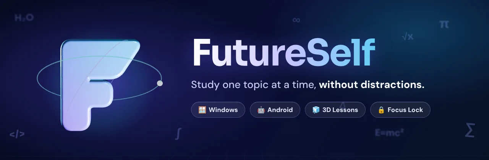
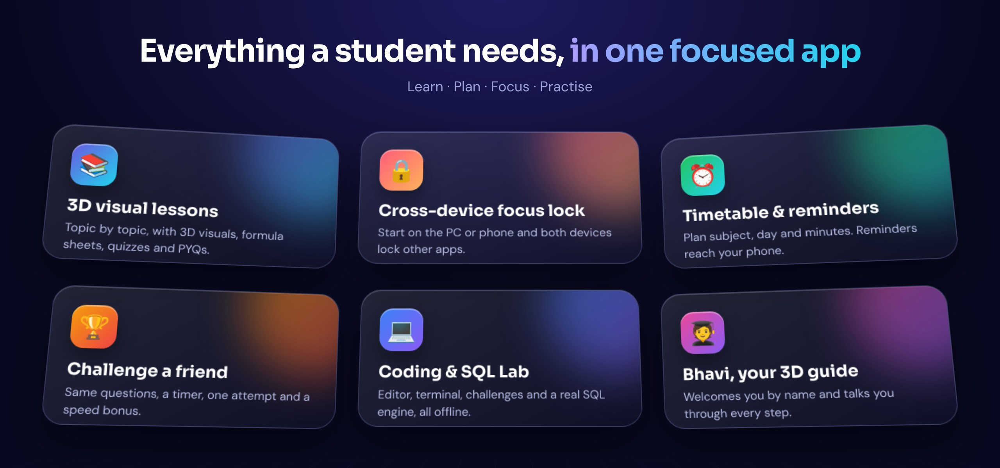
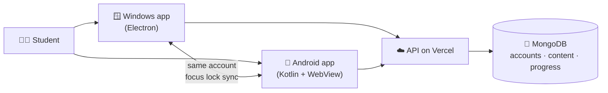
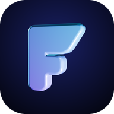

<div align="center">



<br>

<a href="https://futureself-website-e984.vercel.app"></a>
<a href="../../releases"></a>
<a href="../../issues/new"></a>

<br>


</div>

---

## ✨ About

Students lose hours to notifications, reels and *"just one more video"*.
**FutureSelf removes those distractions.**

Students choose what they are preparing for, plan when to study, and start a **focus session**.
During the session, the app locks other apps on **both the phone and the computer**, and shows only the lesson for the current topic.

<div align="center">
<br>

<br><br>
</div>

## 🚀 Features

<table>
<tr>
<td width="50%" valign="top">

### 📚 Learning
- **Topic-by-topic lessons** with pictures, 3D visuals, formula sheets, Q&A and quizzes
- **Wide syllabus:** Class 9–12, JEE Main & Advanced, NEET, B.Tech Sem 1–8, CA, NDA, government exams and GK
- **Previous-year questions** labelled with exam and year
- **In-session videos** chosen by the app, limited to the current topic
- **Hindi and English** content, with a built-in dictionary

</td>
<td width="50%" valign="top">

### 🔒 Focus & planning
- **Focus lock** with Gentle, Focus and Strict modes
- **Cross-device lock:** start on the PC and the phone locks too
- **Emergency contacts:** up to five numbers stay reachable
- **Timetable** with reminders on the phone
- **Progress:** streaks, scores and weak topics

</td>
</tr>
<tr>
<td width="50%" valign="top">

### 💻 Practice & coding
- **Challenge a friend:** same questions, timer, one attempt, speed bonus
- **Coding platform** inside the Windows app: editor, terminal and challenges
- **SQL Lab:** a real SQLite engine (WebAssembly) that understands MySQL syntax, fully offline

</td>
<td width="50%" valign="top">

### 🧑‍🎓 Guidance
- **Bhavi, the 3D student guide**, who welcomes you by name
- **Voice guide** that reads every step aloud
- **Animated "how to" clips** for each phone permission
- **Interactive guided tour** of the whole app

</td>
</tr>
</table>

## 🧩 How it works



## 🛠️ Tech stack

<div align="center">


</div>

| Platform | Technology | Folder |
|:--|:--|:--|
| 🪟 Windows | Electron | [`app/`](app) |
| 🤖 Android 8.0+ | Kotlin + WebView (min SDK 26, target SDK 34) | [`android/`](android) |
| 🌐 Website & API | Static site + serverless API on Vercel | [`website/`](website) |
| 📦 Windows installer | Go | [`installer/`](installer) |

## 📁 Project structure

```
futureself/
├── app/                 Windows app (Electron)
│   ├── main.js          main process
│   ├── core/            accounts, storage, content, phone link, app blocker, updates
│   └── renderer/        screens: HTML, CSS and JavaScript
├── android/             Android app (Kotlin + WebView)
├── mobile/              builds the web layer used by the Android app
├── website/             download website and API (Vercel)
├── installer/           Windows setup builder (Go)
├── Content/             study content by class, exam and semester
├── tools/               content and build scripts
├── .github/workflows/   automatic Android builds and content seeding
├── dotenv.template      configuration template
├── DEPLOY.md            hosting and release guide
└── SECURITY.md          security notes
```

## ⚡ Getting started

<details open>
<summary><b>Run the Windows app</b></summary>
<br>

**Requirements:** [Node.js](https://nodejs.org) 20+ and [Git](https://git-scm.com). [MongoDB Atlas](https://www.mongodb.com/atlas) is optional; without it, data is saved in a local file.

```bash
git clone https://github.com/Bhavishaya789/futureself.git
cd futureself
npm install
cp dotenv.template .env      # Windows PowerShell: copy dotenv.template .env
npx electron app
```

</details>

<details>
<summary><b>Configuration (.env)</b></summary>
<br>

All settings are in `.env`. See [`dotenv.template`](dotenv.template) for the full list.

| Variable | Purpose |
|:--|:--|
| `SECRET_KEY` | Long random text used to sign logins (**required**) |
| `STORAGE` | `auto`, `mongo` or `file` |
| `MONGO_URI`, `MONGO_DB` | MongoDB connection |
| `NTFY_SERVER`, `TELEGRAM_BOT_TOKEN` | Phone reminders |
| `PISTON_URL`, `GEMINI_API_KEY` | Coding platform ([setup](website/CODE-SETUP.md)) |

> [!WARNING]
> Never commit your `.env` file. It contains private keys and passwords.

</details>

<details>
<summary><b>Build the Android app</b></summary>
<br>

- **Android Studio:** open the `android` folder, wait for Gradle to sync, then choose **Build › Build APK(s)**.
- **GitHub Actions:** open **Actions › Build Android APK › Run workflow**. Enter a release tag to attach the APK to that release.

If you change the app screens, rebuild the Android web layer first:

```bash
cd mobile
npm install
node build.js
```

More details: [`android/BUILD_ANDROID.md`](android/BUILD_ANDROID.md)

</details>

<details>
<summary><b>Deploy the website</b></summary>
<br>

The `website` folder is deployed on Vercel. See [`DEPLOY.md`](DEPLOY.md) and [`website/SETUP_ACCOUNTS.md`](website/SETUP_ACCOUNTS.md).

</details>

## 📥 Download

Get the latest **Windows installer** and **Android APK** from the [Releases](../../releases) page or the [FutureSelf website](https://futureself-website-e984.vercel.app).

> [!NOTE]
> Windows may show *"Windows protected your PC"* because the installer is not code-signed yet. Click **More info › Run anyway**.
> On Android, allow *"Install unknown apps"* for your browser or file manager.

## 📱 Phone set-up

On first launch, **Bhavi** walks you through each permission the focus lock needs:

| Step | Permission | Why |
|:--:|:--|:--|
| 1 | 🔔 Notifications | Study reminders and the "phone locked" notice |
| 2 | 📞 Phone calls | One-tap calls to emergency contacts |
| 3 | 🪟 Display over other apps | Shows the study screen on top of other apps |
| 4 | ♿ Accessibility (app lock) | Notices when another app is opened during a session |
| 5 | 🔋 Battery | Keeps the lock working with the screen off |

> FutureSelf only checks **which** app is open. It never reads what is on the screen.

## 🛡️ Security

Passwords are stored as salted hashes, sign-in tokens are encrypted on every device, and all traffic uses HTTPS.
See [`SECURITY.md`](SECURITY.md) for details. To report a vulnerability, please contact the maintainer privately instead of opening a public issue.

## 🤝 Contributing

Bug reports and suggestions are welcome.

1. Open an [issue](../../issues) describing the bug or idea.
2. Create a branch: `git checkout -b fix/short-description`
3. Commit with a clear message and open a pull request that links the issue (`Fixes #12`).

## 👤 Author

<table>
<tr>
<td></td>
<td>

**Bhavishya Kumar**<br>
B.Tech CSE student · Full-stack developer<br>
<a href="https://github.com/Bhavishaya789">@Bhavishaya789</a>

</td>
</tr>
</table>

## 📄 License

All rights reserved. This project is not open source at this time.

<div align="center">
<br>
<sub>Made with 💜 for students who want to meet their future self.</sub>
</div>
